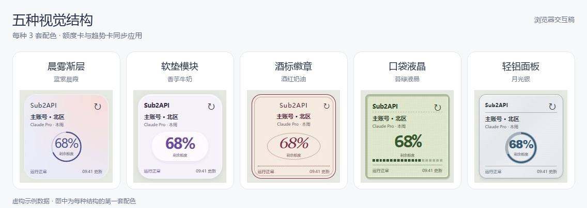
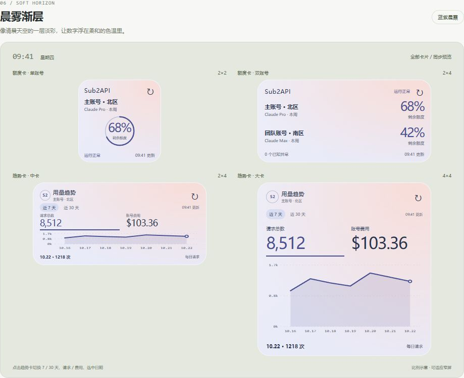

# Sub2API Monitor

Sub2API Monitor 是一款 HarmonyOS 原生手机应用，用于查看自己部署的 Sub2API 实例中的上游账号额度和用量。应用直接连接用户填写的 HTTPS 服务地址，不经过项目方服务器。

## 功能

- 在应用内查看上游账号列表、账号状态和可确认的剩余额度。无法确认的额度显示 `--` 和“额度未知”，不会按 0% 处理。
- 将关注账号添加到桌面额度卡：2×4 卡片展示最多两个账号，2×2 卡片独立展示一个账号。
- 用量趋势卡支持 2×4 和 4×4 尺寸，可切换近 7/30 天、请求数与账号费用，并查看选中日期的数据。账号费用不等于上游套餐剩余额度。
- 支持手动刷新、自动请求间隔与失败退避；请求失败时保留上次成功的数据并标明状态。
- 可设置卡片标题、5 种视觉结构与各 3 套配色，统一应用于四类卡片。连接配置、关注账号及展示快照保存在设备本机。

当前按 Sub2API `v0.2.8` 的管理端接口实现，读取账号列表、选中账号的额度信息和账号日统计。需要能访问这些接口的 Admin Key。

## 效果预览

5 种视觉结构，每种提供 3 套配色，统一适配额度卡 2×2、额度卡 2×4、趋势卡 2×4 和趋势卡 4×4。以下图片来自浏览器视觉交互稿，使用虚构示例数据；原生卡片的字体、留白与材质以 HarmonyOS 真机效果为准。



点击风格名称可查看该风格第一套配色的四类卡片完整预览。

| 视觉结构 | 配色一 | 配色二 | 配色三 |
| --- | --- | --- | --- |
| [晨雾渐层](design/previews/aurora.png) | 蓝紫晨霞 | 青杏薄雾 | 粉桃云层 |
| [软垫模块](design/previews/cushion.png) | 香芋牛奶 | 开心果乳酪 | 桃子酸奶 |
| [酒标徽章](design/previews/label.png) | 酒红奶油 | 橄榄藏品 | 海盐蓝章 |
| [口袋液晶](design/previews/pixel.png) | 苔绿液晶 | 灰蓝电子纸 | 蜜茶屏幕 |
| [轻铝面板](design/previews/chrome.png) | 月光银 | 香槟铝 | 玫瑰钛 |

<details>
<summary>展开查看四类卡片完整预览（晨雾渐层）</summary>



</details>

### 本地交互预览

下载源码后，在仓库根目录执行：

```sh
python -m http.server 8765 --bind 127.0.0.1 --directory design
```

打开 [本地交互稿](http://127.0.0.1:8765/visual-style-exploration.html)，可切换全部 15 种搭配、深浅桌面背景、额度状态，以及趋势卡的 7/30 天、请求/费用和选中日期。交互稿无需配置服务地址或 Admin Key。

## 开发运行

1. 安装 DevEco Studio 6.0.2 和 HarmonyOS SDK API 22；项目要求 API 22 及以上的 HarmonyOS 手机。
2. 首次克隆时，将仓库根目录的 `build-profile.example.json5` 复制为 `build-profile.json5`。已有本机配置时不要覆盖。在 DevEco Studio 中为 `entry` 模块配置调试签名；当前开发包名为 `team.maiga.sub2apimonitor`，需与签名使用的应用配置匹配。本机签名配置与证书文件不要提交到仓库。
3. 用 DevEco Studio 打开仓库根目录，选择 `entry` 模块、`default` 产品和 `debug` 构建模式，连接手机后运行。未配置签名时可以生成未签名 HAP，但不能直接安装到手机。
4. 启动应用后，按下方步骤填写自己的 Sub2API 连接信息，再到“卡片”页选择关注账号并保存。随后从手机桌面添加对应的服务卡片。

运行契约测试需要 Node.js/npm。在仓库根目录安装依赖后执行：

```sh
npm install
npm run test:contract
```

## 连接配置

在首页点击“配置”，填写：

- **服务地址**：自己的 Sub2API 实例根地址，例如 `https://sub2api.example.com`。若部署在反向代理子路径下，填写该子路径；不要附带 `/api/v1`、查询参数或账号密码。设备需要能够访问这个 HTTPS 地址。
- **Admin Key**：该实例的管理端密钥。首次配置或更换服务地址时必须填写；地址不变时可留空以保留已保存的密钥。

保存后返回首页刷新账号列表。在“卡片”页分别选择双账号额度卡、单账号额度卡和趋势卡的关注账号，并设置外观与刷新间隔。更换服务地址或密钥会清除旧快照和关注账号；“删除本机配置”会删除本机保存的连接信息、快照和卡片偏好。若桌面卡片未能清空，应用会提示移除卡片。

Admin Key 使用设备 HUKS 加密并存放在应用私有配置中，不会回填到输入框。请勿将密钥、含密钥的日志或真实接口响应提交到仓库。网络请求会拦截所有 3xx 重定向，不会主动向跳转地址再次发送 Admin Key；请填写最终可用的 HTTPS 地址。此行为仍需在 API 22 真机上通过跨来源重定向抓包验证，验证前不要分发安装包。

隐私说明见 [PRIVACY.md](PRIVACY.md)，项目采用 [MIT License](LICENSE)。

开源源码时不要打包整个本机工作目录：被 Git 忽略的 `build-profile.json5`、`.hvigor/`、`.idea/` 和 `entry/build/` 可能包含签名口令、本机路径或调试产物。只发布已审核的 Git 跟踪文件，不分发本机调试 HAP。
